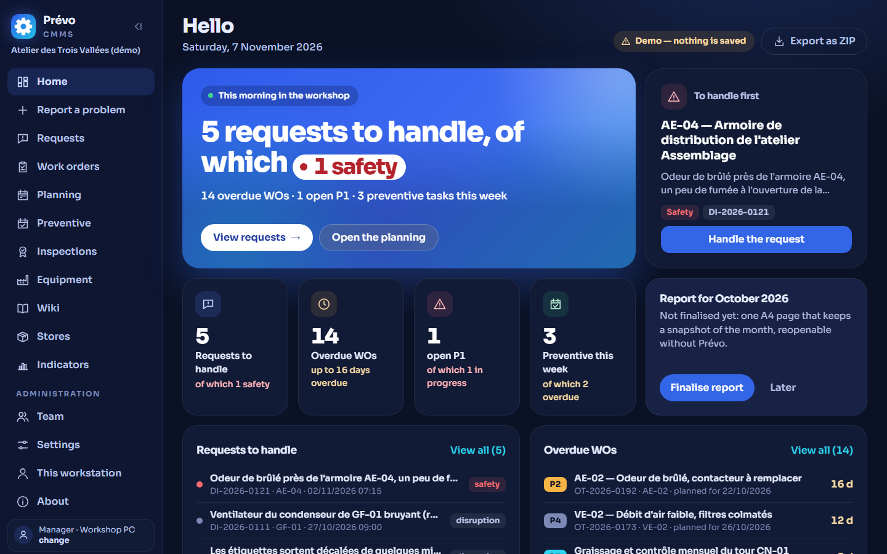

# Prévo

*Version française : [README.fr.md](README.fr.md)*

**The free, open-source CMMS for small industrial companies.**

Website: **[prevo.pro](https://prevo.pro)** · Online demo: **[prevo.pro/demo](https://prevo.pro/demo/)** ·
Download: **[latest version](https://github.com/nicoboy49/prevo/releases/latest)**

> **Prévo 2.0** brings the installation wizard, accounts and access from a phone, English alongside
> French, a versioned data format with automatic backups, and ZIP export and import. Version 1.2.1 stays
> available for anyone who does not want to change yet. Before updating, copy your data folder; report
> any problem in the *Issues* tab.

> **Coming in 2.2 (not yet released)** — the principle, as shown on screen: « Prévo est une aide au suivi ; la responsabilité reste celle de l'employeur. »
> (Prévo is an aid to follow-up; the responsibility remains the employer's.) It reminds you of due dates and keeps
> the evidence; every periodicity or duration it suggests has a stated source (nature of the source, reference, review
> date) and can be changed. New: inspection reservations kept line by line, a sourced catalogue of inspections and
> qualifications, blocking of work orders that require a qualification the technician does not hold (the manager
> alone can override, on the record), warranties and service contracts with alerts, and the cost of an hour of
> downtime in the monthly report.

## Who it is for, and why

In many small companies, maintenance lives in a notebook, a spreadsheet or the technician's memory.
The CMMS products on the market are expensive, slow to deploy and designed for large teams. Prévo is
for companies of fewer than 50 people whose maintenance rests on 1 to 3 technicians: it is free, runs
on a workshop PC, can be used from a phone, and keeps the data in CSV files that stay with the company.
It was designed by a maintenance technician turned trainer, from twenty years in the field.

Prévo is a CMMS (computerised maintenance management system) for a workshop or a small industrial
site: equipment register, work requests, work orders, preventive maintenance and suggested preventive
maintenance, parts store, planning, statutory inspections, indicators and a monthly report.
It runs without a heavy installation or a subscription: the data is CSV files that open in
Excel, stored in a folder of your choice. The interface is in French and English; the code is written in
French, with bundled libraries. What leaves the PC is described below
([Privacy](#privacy)).

- **User guide**: [GUIDE.en.html](GUIDE.en.html) (French version: [GUIDE.html](GUIDE.html)), to open in
  the browser (printable).
- **File format**: [FICHE_TECHNIQUE_CSV.md](FICHE_TECHNIQUE_CSV.md) (in French).
- **Roadmap**: [ROADMAP.md](ROADMAP.md) (intentions, no dates).

**2.0** contains **work packages 1 to 7** of the specification, including the maintenance wiki, taking over
existing data (package 5) and secure access with its installation wizard (package 7), and the
multilingual work (French and English); what is new in each version is in [CHANGELOG.md](CHANGELOG.md) (in French).

## Try it in 30 seconds

1. Open `index.html` in Chrome or Edge (double-click, or drag and drop into the browser).
2. Click **Try it with the demo data**, then choose a profile (**Manager** sees
   everything).

The demo set is an entirely fictional workshop, with thirteen months of history whose dates are
shifted to today. It lives in memory: nothing is saved, and a button lets you export it
as a ZIP. The demo data is in French (the demo set is not translated).

## Installation

1. **Unzip** the zip of the [latest version](https://github.com/nicoboy49/prevo/releases/latest) and put its
   folder at `C:\Prevo` (recommended; elsewhere, the wizard offers to move it there).
2. **Double-click `Lancer_GMAO.bat`**: Python is in the zip, there is nothing else to install. On Mac
   or Linux: `./lancer.sh` (Python 3.11 or newer).
3. **Follow the wizard** that opens in the browser: three questions (who uses Prévo, from where, your
   account) and the language of Prévo; it sets up the rest and prepares the access sheet to print.

Until the installation is finished, Prévo can be reached only from this PC. Beyond this PC, accounts and
https are mandatory: Prévo refuses to start otherwise. Everything can be redone afterwards in Settings › Access
and installation, on the server PC. The guide details each step ([GUIDE.en.html](GUIDE.en.html), chapters 2 and 8).
Did you have Prévo 1.2 or a 2.0 beta? Put the new version in the same folder: the zip has no
`donnees/` folder, your CSV files stay, and the wizard replaces none of them; Prévo makes a backup
“before the Prévo update”, then brings your data to the current format.

Staying on 1.2? Version [1.2.1](https://github.com/nicoboy49/prevo/releases/tag/v1.2.1) has neither wizard nor
accounts: it installs as described in [its README](https://github.com/nicoboy49/prevo/blob/v1.2.1/README.md)
(folder mode in Chrome or Edge, or server mode with Python 3.8 or newer).

### Which installation for you?

| | Solo | Workshop | Intranet | Hosted |
| --- | --- | --- | --- | --- |
| **Who it is for** | One person doing maintenance | A team of 1 to 3 technicians, and requesters | A company with an IT person | A company that does not want to install anything |
| **Where Prévo runs** | Your PC | A PC or mini-PC in the workshop | A company server | At a hosting provider |
| **Who installs it** | You, with the wizard | The manager, with the wizard; then two minutes per phone, once only | The IT person, with [docs/INSTALLATION.md](docs/INSTALLATION.md) | A service provider |
| **Phone in the workshop** | Yes, with your password | Yes, QR labels included | Yes | Yes |
| **Phone outside the workshop** | Yes, through a private network (Tailscale) | Yes, through Tailscale | Through the company VPN | Yes |
| **Accounts** | None on this PC alone; yours as soon as a phone connects | One per technician; requesters by enrolled phone (QR, no password) | One per person, requesters included | One per person |
| **Starts with the machine** | Optional | Yes | Yes (scheduled task or service) | — |
| **Backups** | Every day, and an external copy every night | Every day, and an external copy every night | Every day, and the company's own | The host's |
| **Available** | In Prévo 2 | In Prévo 2 | In Prévo 2 | On request, from SELECTIS (https://selectis.eu) |

Hosted is not in the zip: it is a service, studied on request with SELECTIS.

### For the IT person

Configuration (`prevo.config.json` and each of its keys), reverse proxies (`tailscale serve`, Caddy, nginx,
IIS, Cloudflare Tunnel), start-up as a scheduled task or a service, accounts, logs, backups, updating and
uninstalling: [docs/INSTALLATION.md](docs/INSTALLATION.md) (in French:
[docs/INSTALLATION.fr.md](docs/INSTALLATION.fr.md)). This document is not in the zip: read it in the repository
(https://github.com/nicoboy49/prevo/blob/main/docs/INSTALLATION.md).

### Firewall and phones

When Prévo starts with the PC, the wizard itself adds a rule to the Windows firewall, limited to the
workshop's private network. Otherwise, on the first launch on the network, Windows asks to allow Python: **tick
only “Private networks”**, never “Public networks”.

A phone must be on the **same Wi-Fi** as the server PC (or on the private Tailscale network). It scans the QR
code on the manager's home screen, or the address on the access sheet. The first time, the page “Trust the workshop PC”
guides the installation of the workshop certificate (Android, iPhone); after that, Prévo opens over https,
with the camera and the microphone. A requester has no password: the manager sends an invitation (QR).

In server mode, the data is in the `donnees/` folder (outside the git repository), with the daily backups
(`donnees/sauvegardes/`), the attached documents and the accounts (`donnees/acces/`).

### Folder mode (one workstation, no server)

Open `index.html` in **Chrome or Edge**, click “Choose the data folder” and pick a folder on your PC: Prévo reads
and writes the CSV files there. This mode is meant for **one workstation at a time**, with no phone and no
account; “Resume the previous folder” saves you from choosing it again. It uses the file access API of Chrome
and Edge; Firefox and Safari do not offer it. To work as a team, with phones or with the AI assistant, install
Prévo (above): even alone on a PC, that is the recommended mode.

## Features by module

- **Three storage modes**: folder, local Python server, in-memory demo. Concurrent writes are
  handled: in case of a conflict, the change is replayed on the most recent version of the file
  (three attempts). Tables changed on another workstation are re-read automatically.
- **Roles** Requester, Technician and Manager: menus and screens adapted. With accounts, the server checks
  the role on every request (a requester sees neither costs nor technicians, a technician sees neither hourly rate nor prices);
  without accounts (this PC alone, folder mode, demo), the profile only adapts the screens.
- **Access and accounts** (server mode): three scopes (this PC, the workshop Wi-Fi, also outside the workshop);
  beyond this PC, sign-in and https are mandatory. Accounts checked by the server (password kept as a
  hash, lock-out after ten failures, “Stay signed in on this device”), created and deactivated in Team ›
  Access, with an exportable sign-in log; requesters' phones enrolled by an invitation QR, with no
  password, revocable at any time. https without buying anything: an http front door leads each
  device to https, with a certificate that Prévo makes for the workshop; outside the workshop through Tailscale, without
  opening the router; start-up with the PC (Windows scheduled task, systemd service). Installation wizard in three
  questions, printable access sheet, and Settings › Access and installation to redo everything from the server PC.
- **Solo mode** (one person does everything): the manager profile with a lighter menu, “New WO” first, the
  technician “me” pre-filled and closing in one step.
- **Home** by profile: the manager's counters (requests to process, overdue work orders, open P1s, preventive tasks
  of the week, items to order, inspections within 30 days, qualifications to renew, preventive
  suggestions), the technician's work orders, the requester's requests; sign-in QR code in server mode.
- **Work requests**: entry in five questions (on a phone too, photo included),
  priority calculated from criticality and impact (“safety” always gives P1),
  manager decisions (accept, group, defer, refuse with a reason the requester can see).
  A panel shows the frequent causes of the same symptom, with how solid its figures are.
- **Work orders**: full life cycle (prepared, scheduled, in progress, technical and
  administrative closing, on hold and cancellation with a reason), checked technical closing (cause and
  remedy codes, job report, return to service), qualification checked at assignment, lock-out
  procedure displayed, parts issued from the work order, calculated cost, printable A4 work sheet,
  CSV export of the list.
- **Weekly planning**: one row per technician with their load and capacity, work orders to schedule
  dragged onto a day or placed with “Schedule…” (no mouse needed); list by day on a phone.
- **Preventive maintenance**: routines triggered by a date, a counter or a measurement threshold; one work order per
  due routine, created on opening with its checklist; closing updates the routine; calendar of the
  next 12 weeks; anomaly seen during a preventive task → linked request in one click.
- **Suggested preventive maintenance**: Prévo re-reads the history and proposes creating a routine, reviewing the
  preventive maintenance, reviewing a routine whose visits often find an anomaly, or lengthening a
  routine with no findings (never for criticality A). Each suggestion shows its rule and its facts; Prévo
  **never changes a routine by itself**, and every decision is written to the log.
- **Store**: items, movements, stock recalculated from the movements, issue refused if the stock
  would go negative, suggested reorder point, “To order” list, purchase requests from
  “requested” to “received”, suppliers, stocktake.
- **Equipment register and QR labels**: site, workshop, line tree; equipment sheet (history,
  counters, routines, inspections, parts); QR labels in batches on A4 sheets of 24 or 8, with the
  reference written in plain text.
- **Statutory inspections**: schedule by equipment, inspection done with its report, closing
  of the observations, pre-filled statutory work order (no regulatory watch).
- **Team and qualifications**: technicians, capacity, qualifications and their expiry dates, history of
  renewals.
- **Indicators** (manager): availability, MTBF, MTTR (including waiting for parts), downtime, share
  and compliance of preventive maintenance, overdue work orders, response times, costs, stock value; each
  figure says how many work orders it covers, and a figure that cannot be calculated says why. Charts with
  their values in a table, CSV and image exports.
- **Frozen monthly report**: one A4 page per month (compared figures, highlights, points to
  review including “repair or replace?”), which reopens without Prévo; “Prepare an email”
  opens the workstation's email application, Prévo sends nothing itself.
- **Settings**: shared settings, failure codes, backups (test of a backup, external copy
  every night in server mode) and restore, database check, ZIP export.
- **Taking over your data** (manager): the “Import data” wizard takes over, in five steps,
  a workshop's lists (locations, equipment, items, suppliers, technicians and
  qualifications, codes, counters, inspections, routines) and the job history from another CMMS, from Excel (.xlsx,
  .xls), OpenDocument (.ods), CSV or a paste: columns recognised by their heading (the AI can suggest some,
  from the headings only), row-by-row preview before anything is written, backup just before, “Cancel this
  import”.
- **AI assistant** (optional, off by default): Ollama on a workshop PC (recommended model
  `qwen2.5:7b`) or an OpenAI-compatible API. It suggests a symptom and an impact for a request, a
  structured job report, failure codes taken **only** from the existing list, a routine
  checklist, a comment for the monthly report and the texts of the maintenance wiki (below).
  The AI proposes, the human validates (“Use”, “Edit”, “Ignore”): nothing is written without a click.
  A permanent notice says where the texts go (“stays on this PC”… “data sent to …”). In server
  mode, the provider, its address and its key are set once on the server PC, never in a browser, and the server relays
  requests from all workstations; an online provider can be used only if the server PC allows it. With
  accounts, the AI is reserved for technicians and the manager. In folder mode, the key stays in the workstation's browser.
- **Maintenance wiki**: the workshop's encyclopaedia (“Wiki” menu): one page per machine, breakdown,
  item, technician, job and know-how, all linked. The facts (breakdowns, jobs,
  parts, stock, qualifications) are calculated by Prévo without AI, and the search does not use AI.
  With the AI assistant, each administratively closed work order enters a queue that the manager
  processes whenever they like (“Process the queue”): the AI proposes short texts (“In brief” and
  “Tips” of a machine, “What it is for” of an item, know-how drawn first from the “Tip for next
  time” entered at technical closing), Prévo checks them (every sentence cites a work order,
  no number or date from outside the work order, no counting, no safety instruction, lengths) and the
  manager approves, rejects or reruns; a contradiction is flagged on the page (“To be settled”),
  never overwritten. Cost measured on the demo with Claude Sonnet (`claude-sonnet-5-5`): 227 work orders integrated
  for $5.16, or $0.026 per work order (about 2.5 cents); it depends on the provider and the length
  of the job reports; nothing is charged with Ollama.
- **Dictation**: microphone button on long text fields, text added at the end of the field,
  warning on first use (the voice is transcribed by Google or Microsoft), can be turned off
  per workstation; without a secure page, Prévo points to the keyboard's microphone.
- **This workstation**: screen open to everyone for the browser settings (language, profile and workstation name without accounts,
  AI assistant, dictation, **light theme** or dark).
- **Languages**: see [below](#languages).
- **Input kept and drafts**: if the session ends during data entry, the sign-in screen appears without
  erasing anything, and the same account gets its input back. A problem report and a work order's job report
  are kept as you type in the device's browser, for the account that typed them (7 days at most): a
  phone left on standby finds them again.
- **Update notice** (on by default, can be turned off in Settings › Updates): Prévo reads
  `https://prevo.pro/version.json` at most once a day per workstation and says, on the manager's home screen and in
  “About”, that a newer version exists, with the download link (prevo.pro or this repository
  only). A banner explains it once. Nothing installs by itself; never in the demo.
- **“Suggest an improvement”** (About and foot of the menu): opens a GitHub form pre-filled with the
  version, the language and the browser, nothing else; failing that, contact@prevo.pro.
- **Guide and data sheet**: [GUIDE.en.html](GUIDE.en.html) and [GUIDE.html](GUIDE.html) (self-contained, printable,
  with screenshots) and [FICHE_TECHNIQUE_CSV.md](FICHE_TECHNIQUE_CSV.md), generated from the schema.

## Languages

Prévo is shown in **French**, **English** (British English), **Turkish**, **Italian** and **Portuguese** (Portugal);
numbers, amounts and dates follow the format of the language. Turkish, Italian and Portuguese are machine
translations (the interface says so, corrections welcome); their long help and the guide are in English. The language follows this order: that of the signed-in **account**, otherwise the choice made on **this
workstation** (or on the phones' front door), otherwise the **installation language** (Settings › Company). The demo
opens in the browser's language. The texts that Prévo writes itself into the data (work order history, pre-filled
titles…) are in the installation language; list values stay in French in the CSV files, and are translated on screen.
The currency can also be set (EUR by default), with no conversion of amounts. The demo data is in French (the demo
set is not translated).

**Adding or fixing a language**: see [CONTRIBUTING.md](CONTRIBUTING.md#add-or-fix-a-language), or report a wrong
translation with the "Fix a translation" form (Prévo links to it).

## Privacy

Prévo collects nothing: no statistics, no installation identifier, no account with us. Your data
stays in your folder, on your PC. What can leave the PC, and when:

- **New-version notice** (on by default, can be turned off): one read per day and per workstation of the
  public file `https://prevo.pro/version.json`, with no cookie, no page address, no redirect. The
  prevo.pro server sees, as for any page, the IP address and the browser. Never in the demo.
- **AI assistant** (off by default): with Ollama on a workshop PC, nothing leaves; with an online AI,
  the texts sent (a fixed list of fields, described in the guide) go to the chosen provider, and a
  permanent notice says so.
- **Dictation**: in Chrome and Edge, the voice is transcribed by Google or Microsoft; Prévo says so on first
  use, and dictation can be turned off in “This workstation”.
- **“Suggest an improvement”**: only when you click; opens GitHub with the Prévo version, the
  language and the shortened browser (for example “Chrome 130, Windows”), nothing else.
- **Tailscale** (access outside the workshop, if you choose it): a third-party service, with its own account.

Drafts stay in the device's browser; backups and the external copy stay with you.

## Data format

The data is 27 CSV files (format 3 since package 6): separator `;`, UTF-8 with BOM,
CRLF line endings. They open and can be edited in Excel. Because Excel damages some values
(leading zeros, formulas, fractions taken for dates), Prévo protects them with an apostrophe
at the start of the cell and removes it when reading. When reading, it also accepts the dates written
`DD/MM/YYYY` by Excel. Each file and each column is described in
[FICHE_TECHNIQUE_CSV.md](FICHE_TECHNIQUE_CSV.md) (in French).

Do not edit a file in Excel while someone is saving in Prévo: the server
reports a locked file, and folder mode detects the conflict.

To run the tests or contribute: see [CONTRIBUTING.md](CONTRIBUTING.md); to report a vulnerability:
[SECURITY.md](SECURITY.md) (never in a public issue).

## Known limitations

- **A certificate to accept on each device.** On the workshop Wi-Fi, each phone and each other workstation
  trusts the workshop PC once, guided by Prévo's page; until then, it stays on that page and does not open
  Prévo. A certificate supplied by the IT person, or access through Tailscale, avoids this step.
- **Outside the workshop, you need Tailscale or a VPN.** Tailscale requires an account with Tailscale (a third-party
  service), and its app on the server PC and on each phone. Prévo never opens the router. Expose Prévo
  on the Internet only behind Tailscale, the company VPN or a reverse proxy over https
  ([docs/INSTALLATION.md](docs/INSTALLATION.md)): Prévo has no two-factor authentication.
- **No company directory.** No Active Directory, no LDAP, no single sign-on: local accounts, the export
  of the sign-in log, and the company's reverse proxy or VPN for your own access controls.
- **Hosting is not provided.** Prévo installs on your premises, on a PC that must stay on; hosting
  is discussed on request with SELECTIS.
- **Without accounts, profiles protect nothing.** On this PC alone, in folder mode and in the demo, everyone chooses their
  profile: profiles adapt the screens. That is why Prévo refuses to listen on the network without accounts and https.
- **The server serves only the application.** It answers only for `index.html`, `favicon.svg`, `GUIDE.html` and
  the `css/`, `js/` and `acces/` folders (the front door): it is an allow-list. Any other file in the folder
  (`README.md`, `docs/`, `tests/`, `outils/`, `serveur.py`…) answers “not found” (404). Data goes only
  through the application's API, after sign-in and according to the role; `donnees/acces/` (accounts, sessions) is
  never served.
- **Python.** The zip bundles Python for 64-bit Windows; elsewhere, Python 3.11 or newer is needed (and, for
  the workshop certificate, the system's mkcert: see [docs/INSTALLATION.md](docs/INSTALLATION.md)).
- **Chrome or Edge required for folder mode** (file access API).
- **Memory use of ZIP export and import measured under Chrome only**: Edge and Firefox were not measured.
- **Parts cost at the current price.** A work order's cost uses the item's current price; a
  purchase receipt does not change that price (the manager changes it by hand), but a price change
  also changes the cost of past work orders, and so the cost indicators. A frozen monthly
  report, however, keeps the figures of the day it was frozen (“Recalculate” creates a new version).
- **QR labels and the PC's address.** In server mode, the QR contains the PC's network address (that of the
  front door, in http: it does not change with https). If it changes (the router assigns another
  address, the port changes), the labels already stuck on no longer lead to the sheet: reserve a fixed address
  for this PC in the router. In folder and demo modes, the QR contains `GMAO:<identifier>`, readable only by
  Prévo's scan on this workstation.
- **Indicators are only as good as the data entry.** MTBF, MTTR and availability rest on the downtime
  entered at closing and on the operating hours per day of each piece of equipment; equipment
  without these hours is excluded, and the list of exclusions is shown. “Of which waiting for
  parts” is calculated only for breakdowns whose whole history is in Prévo's log (not for
  a work order added by hand in Excel).
- **Suggestions are facts to examine.** They count breakdowns by the cause coded at
  closing: a wrongly coded cause skews the count. For “review the preventive maintenance”, all causes
  count, even those a routine does not target: ignore the suggestion with a reason. On a database
  moved from format 1 to format 2, only the visits made after that move count for “lengthen
  a routine” (before, the absence of an anomaly was not recorded).
- **AI assistant.** A proposal can be wrong: it is always reviewed before being used.
  A local model is slow without a graphics card (more than a minute per answer is possible). In folder
  and demo modes, Ollama refuses the page opened from disk: for the AI, run Prévo in server mode,
  even alone on a PC. An online provider receives the texts sent.
- **Maintenance wiki.** It is built only from administratively closed work orders; its written
  texts are checked and approved, but still need reading. The demo wiki texts were written
  by Claude Sonnet (one agent per work order, with Prévo's instructions) and then reviewed: they describe a fictional
  workshop. The cost per work order was measured only with this provider; with a local AI (Ollama), nothing is
  charged, but the quality of the texts and the time taken were not measured.
- **Dictation.** It depends on the browser: Chrome and Edge send the voice to Google or Microsoft, and
  the microphone is allowed only on a secure page (on the PC itself, or over https).
- **Two languages for now.** French and English; the demo data, the console's request log and the
  command-line help (`--aide`) stay in French.

## How this project was made

The specification was written by Nicolas Briand with Claude; the code was then produced
by Claude Code sub-agents, under the coordination of an orchestrator that accepts a task
only if its verification passes, with an independent review at each step. In short:
[docs/METHODE.md](docs/METHODE.md); the method and the evidence, package by package:
[docs/PILOTAGE.md](docs/PILOTAGE.md) (in French).

## Licence and credits

Code under the MIT licence (see `LICENSE`), Copyright (c) 2026 Nicolas Briand — SELECTIS. For the
third-party libraries and the font, see `NOTICE`.

Prévo bundles, unmodified, PapaParse, qrcode-generator, jsQR, Apache ECharts and SheetJS
Community Edition, as well as the Sora font (SIL Open Font License 1.1). Their licences are reproduced in
`js/lib/LICENCES.txt`; the Windows zip adds Python and mkcert, with their licences (see `NOTICE`).

Everyone takes part in accordance with the [code of conduct](CODE_OF_CONDUCT.md).

## Contact

Nicolas Briand — SELECTIS, industrial maintenance training and consultancy.
Website: https://selectis.eu
Email: contact@prevo.pro
